# Scheduling Manager

<a href="https://www.buymeacoffee.com/flatsheep"></a>

[](https://my.home-assistant.io/redirect/hacs_repository/?owner=flatsheep&repository=scheduling-manager&category=integration)

**A clearer way to manage your Home Assistant schedules.**

Bring heating, hot water, lighting and other supported devices together on
aligned, interactive timelines. See what happens when, which devices each
schedule controls, and how your morning, daytime and evening routines fit together.

Create a schedule, add its devices, choose their Start/Stop settings, then build
its time bands visually. Give each day its own routine, group days that share a
pattern, or mix both. Drag markers for quick adjustments, enter exact times, or
follow sunrise and sunset with offsets.

Scheduling runs inside Home Assistant, even when your dashboard is closed.
Manual device adjustments stay in place until the next relevant transition.

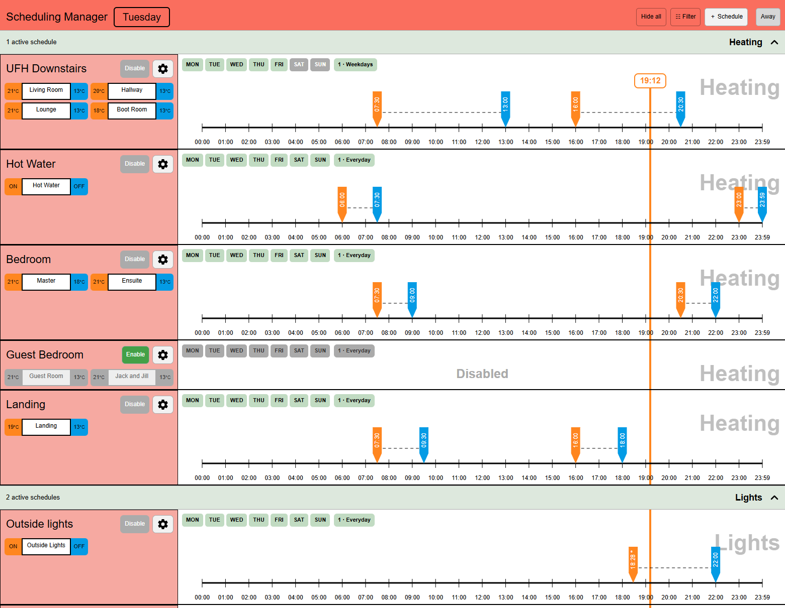

- **Multiple devices per schedule**, each with its own Start/Stop settings, such
  as different room temperatures or ON/OFF states for lights.
- **Named day groups** for weekday, weekend or individual-day routines. Preview
  another day's timetable without changing saved settings or commanding devices.
- **Recurring or one-off bands**, with fixed times or solar events and offsets.
  Temporary bands remove themselves after their cycle completes.
- **Visual editing:** drag markers, enter exact times, and use the same card on
  desktop, tablet or phone.
- **Flexible pauses:** disable schedules, day groups or recurring bands; use Away
  for participating schedules, indefinitely or until a chosen time.
- **HA automation controls**, collapsible categories and area/floor/activity filters.

**Integration and card: 2.0.0 · Home Assistant 2026.7+**
Tested on HA 2026.7.0, 2026.8.1, 2026.9.4 and 2026.10.1.

**Upgrading from 1.x?** Version 2.0 completes the integration's rename. Follow the
[one-time migration](docs/MIGRATION.md) to transfer your existing schedules:
update, restart, add the new integration, then perform the verification restart.
Action names and the default Away entity change, and device-based automation
targets need updating. Read the guide before upgrading; do not delete the old entry first.

[Install](#install) · [Quick start](#quick-start) · [One-offs](#one-off-time-bands)
· [Solar times](#fixed-and-solar-time-bands) · [Pausing](#pause-schedules-or-bands)
· [Away](#away-mode) · [Filters and previews](#categories-filters-and-day-previews)
· [Automations](#automation-controls) · [User guide](docs/USER_GUIDE.md)

## Install

One HACS download includes the integration and its matching dashboard card.
No separate JavaScript resource or YAML is needed.

1. In **HACS → ⋮ → Custom repositories**, add
   `https://github.com/flatsheep/scheduling-manager` with category **Integration**.
2. Download **Scheduling Manager**, then **restart Home Assistant**.
3. Open **Settings → Devices & services → Add integration**, search for
   **Scheduling Manager**, and add it.
4. Create a dedicated dashboard view and choose **Panel (single card)** as its
   view type. Give the view a title, such as *Scheduling Manager*.
5. Choose **Add card → By card**, search for **Scheduling Manager**, then select
   it as the view's single card. Save and leave dashboard editing.
6. Choose **＋ Schedule** to begin your first routine.

Panel layout is recommended because it gives the timelines and device settings
room to sit together. Other dashboard layouts are supported too. The card uses
the **dashboard view's title** as its heading; an untitled view leaves it blank.

Refresh your browser or reopen the companion app if the card is not listed yet.
Updates follow the same pattern: download in HACS, restart HA, refresh the dashboard.
Your saved schedules are retained. This is a HACS **custom repository**, not yet a
default-catalogue entry.

<details>
<summary>Manual installation, YAML cards and older installations</summary>

1. Download [scheduling-manager-2.0.0.zip](https://github.com/flatsheep/scheduling-manager/releases/download/v2.0.0/scheduling-manager-2.0.0.zip)
   from the release.
2. Extract `custom_components/scheduling_manager/` into your HA
   configuration's `custom_components/` directory. Create that directory if needed.
3. Restart HA, then add the integration and dashboard card as above.

For manual updates, replace the integration folder with the new release's folder,
restart HA and refresh your dashboard. Keep the existing integration and schedules.

For YAML dashboards:

```yaml
type: custom:scheduling-manager-card
```

The card loads automatically in YAML mode too. The integration folder and domain
are both `scheduling_manager`. When upgrading from 1.x, use the migration procedure
before retiring the old installation. Legacy card types and action names are not
runtime aliases in 2.0.

</details>

## Quick start

### 1. Add and name a schedule

Choose **＋ Schedule** in the header and enter a name such as *Downstairs heating*
or *Outside lights*. The new schedule opens in edit mode with an empty timetable.
Open an existing schedule's **cog** whenever you want to edit it again.

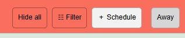

### 2. Add devices and choose their actions

Choose **＋ Entity**, search for a supported writable device, and confirm its
Start/Stop values. Repeat to add other devices that should follow the same times.
Each device can have different values within the same schedule.

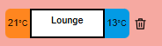

For thermostats, **orange is the Start target** and **blue is the Stop setback**.
For example, Lounge could receive 21°C at Start and 13°C at Stop. Tap either
value while editing to change it. A thermostat's setback is shared across its
schedules; its Start target is specific to each schedule.

For other devices, those positions hold Start/Stop states or values, such as
**ON → Hall light → OFF**. The small trash control removes a device from the
draft; the change takes effect on Save.

### 3. Group days into named sub-schedules

Select the weekdays that should share a timetable; selected days turn green.
Optionally give that group a **Sub-schedule name**, such as *Weekdays* or
*Weekends*. All selected days in the group share its bands.

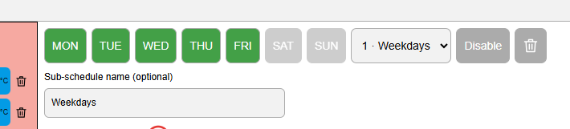

For a weekday/weekend routine:

1. Select Monday–Friday and name the first group *Weekdays*.
2. Use the **＋ beside the sub-schedule dropdown** to add another group.
3. Select Saturday–Sunday and name it *Weekends*.
4. Switch between the groups using the dropdown and add bands to each.

You can instead give every day its own group. Each weekday belongs to only one
sub-schedule within a schedule; days assigned elsewhere cannot be selected until
released from that group. There are up to seven groups and ten bands per group.

### 4. Add time bands

Choose **＋ Add time band**, set **Start** and **Stop**, then press **Apply**.
Repeat for morning, afternoon or evening periods. You can also double-click/tap
a blank timeline gap to create a recurring one-hour band where there is room.

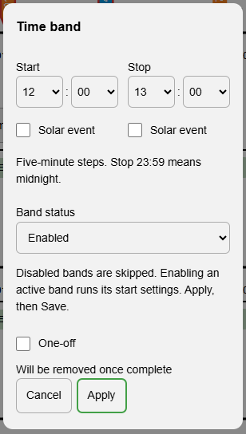

The **orange marker** runs Start settings; the **blue marker** runs Stop settings.
Their dashed line shows the paired interval. While editing, drag fixed-time
markers in five-minute steps or open a band/marker's popup for precise entry.
Solar markers have a `*` and are configured through that popup.

For an overnight routine, use one band to the end of a day and another from the
start of the next. **23:59 as Stop means following midnight**, not a one-minute gap.

### 5. Choose a category and Away participation

Use **Category** to group related schedules, such as *Heating* or *Lights*.
Choose **Away included** if Away should pause this schedule, or **Away excluded**
if it should continue normally. Both choices become active on Save.

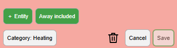

### 6. Save your timetable

**Apply edits the draft; Save activates it. Cancel discards unsaved changes.**
Every retained group needs selected weekdays and the schedule needs at least one
supported entity. Empty day groups are allowed and remain inactive.

After saving, the backend runs the timetable independently of the dashboard.
Ordinary recurring edits affect future transitions; saving during an existing
band does not immediately replay its Start. One-offs have the timing rules below.

## Fixed and solar time bands

Either endpoint can follow the clock or a solar event, independently. For example,
start outside lights at **sunset minus 15 minutes**, then stop them at **23:00**.

1. Open the time-band popup and tick **Solar event** below Start or Stop.
2. Choose Sunrise, Sunset, Dawn, Dusk, Solar noon or Solar midnight.
3. Enter an **Offset (minutes)**, then **Apply** and **Save** the schedule.

A negative offset means before the event; a positive one means after it. Offsets
range from −300 to +300 minutes. The other endpoint can stay at a fixed time.

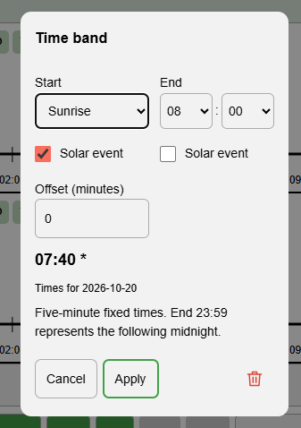

The preview shows the event's resolved time for the displayed date, so a sunrise
shown as 07:40 is not a fixed daily Start. Solar times use HA's configured location
and timezone; no sun entity is required. Solar midnight means the sun's daily low
point, which may differ from clock midnight.

Only fixed endpoints can be dragged. Resolved solar times are kept within the
local day and paired interval. If a solar event is unavailable on a date, the band
skips that occurrence. See the [user guide](docs/USER_GUIDE.md#fixed-and-solar-times)
for clamping and overlap behaviour.

## One-off time bands

For a temporary routine, tick **One-off** when creating a band. Its red marker
borders and calendar-clock badge show that it will expire.

The checkbox starts unchecked, with **Will be removed once complete** underneath.
Apply adds the band to your draft; Save activates it. The One-off choice is only
available during creation, so an existing recurring band cannot be converted.

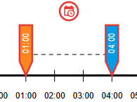

- It runs **one cycle across the selected weekdays**, then is removed from every
  associated day after Stop resolves. An empty day group is retained for reuse.
- Times remain editable. Changing a running band's times keeps the same cycle
  without repeating Start; an overdue edited Stop runs on Save.
- Deletion is always available. Save cancels its remaining work without issuing
  device commands, leaving devices as they are.

When it runs depends on when you save it, assuming today is selected and the
schedule/group is enabled with no applicable Away suspension:

| When you save a 14:00–16:00 one-off | What happens |
| --- | --- |
| Before 14:00 | It waits until 14:00, then runs the full interval. |
| At 15:00 | It starts immediately and stops at 16:00. |
| After 16:00 | It waits for the next selected day; if only today's weekday is selected, that is next week. |

Several selected weekdays offer possible dates for **one cycle**, not one run on
every day. Once its cycle is selected, it does not repeat the following week.

One-offs have no individual disable switch or automation path. Parent controls
still apply, but a selected cycle retains its Stop cleanup through disabling or
Away. Failed Stops remain pending rather than silently expiring.
See [one-off behaviour and recovery](docs/ONE_OFF_BANDS.md).

## Pause schedules or bands

| Control | What it does |
| --- | --- |
| **Schedule Enable/Disable** | Immediate. Disable applies climate setback, leaves other devices unchanged and pauses new transitions. |
| **Sub-schedule Disable** | Pauses a day group's bands permanently or until a chosen time. Apply, then Save. |
| **Recurring Band status** | Disables only that shared band, permanently or until a chosen time. Apply, then Save. |
| **Away** | Pauses participating schedules now, indefinitely or until an automatic return. Excluded schedules continue. |

### Disable a whole schedule

Use **Disable** beside the schedule name in view mode. This is immediate and
shared across clients. **Enable** resumes active recurring Start settings; outside
an active interval, it applies climate setback and leaves other devices unchanged.

A disabled parent preserves the individual enable/disable choices of its groups
and bands. Re-enabling it does not turn a deliberately disabled child back on.

### Disable a sub-schedule or recurring band

1. Open the schedule editor.
2. For a day group, press **Disable** beside the sub-schedule dropdown. For an
   individual recurring band, open its popup and change **Band status**.
3. Choose permanent disabling or **Until…** and enter a re-enable date/time.
4. Press **Apply**, then **Save** the schedule.

| Permanent day-group pause | Timed day-group pause |
| --- | --- |
| 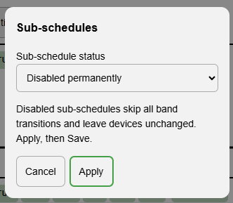 | 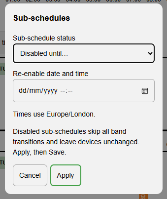 |

Disabled day groups show black weekday buttons with a red ×, and their associated
bands are greyed out without changing the bands' own enabled settings. Individually
disabled recurring bands also stay dark grey. Disabling either leaves devices
unchanged. Enabling or timed expiry applies Start only inside an eligible active
recurring interval, respecting parent controls and Away.

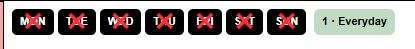

To restore a group or band manually, choose **Enable/Enabled** and Save. A timed
disable survives restarts; if it expires during an eligible recurring interval,
Start settings resume once and the later Stop still runs. Outside the interval,
future transitions simply become available again.

## Away mode

Away is useful for holidays or temporary absences without editing each timetable.
The editor's **Away included/excluded** setting decides which schedules participate;
excluded schedules keep running normally.

1. Press **Away** in the header.
2. Choose **Now** for indefinite Away, or **Until…** for an automatic return.
3. If timed, enter the return date/time in **Home Assistant's timezone**.
4. Press **Enable Away**. Later, reopen the popup to update it or turn Away off.

Away applies setback to participating thermostats and leaves non-climate devices
unchanged. Returning resumes currently active **recurring** routines, without
replaying one-off Starts. A one-off that already started retains its Stop cleanup.

The Away switch and header control operate the same saved flag. Timed returns
survive restarts. Away is immediate and independent of the editor: cancelling an
open schedule draft does not undo an Away toggle.

## Categories, filters and day previews

Use **Category** while editing to assign an existing category, create a new one,
or leave the schedule **Unassigned**. Apply and Save it. Categories become
collapsible groups; **Hide all / Show all** controls them together. Their running
counts reflect timetable activity, not whether a thermostat reports heating.

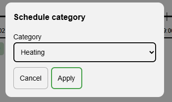

The header's **Filter** popup can narrow the view by category, HA area, floor and
active/inactive status. For example, choose *Heating*, *Downstairs* and *Active now*
to see currently active heating schedules with a matching downstairs device.
Multiple choices within a filter group are combined; different groups narrow the
result together. Leave unrelated groups on **Select all**.

Press **Apply** to change the view or **Cancel** to leave it alone. A green Filter
button and red **×** identify an active filter; × clears it. Filtering and
collapsing only affect your view, not scheduling or device settings.

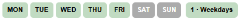

In view mode, today's group is light green and other scheduled days are grey.
Tap a grey weekday to preview its timetable as a dotted overlay without changing
devices. Tap today's group, the same previewed day, the background or Escape to
return. The preview also closes after ten seconds. The numbered/name badge beside
the days opens a chooser for other sub-schedules.

## Automation controls

Schedules, sub-schedules and recurring bands expose native **Disabled** switches:
**on = disabled; off = enabled**. Find their entity IDs under
**Settings → Devices & services → Entities**.

Schedules and their sub-schedules are grouped as parent/child devices on HA 2026.9+:

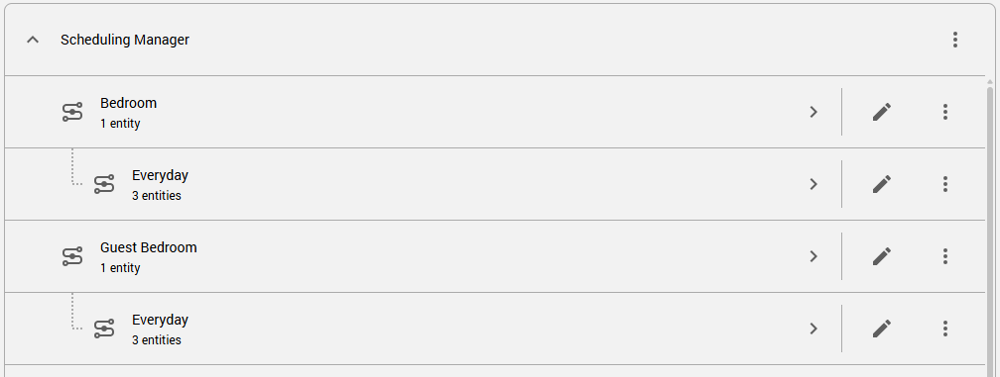

Earlier supported HA versions use flat service devices. Existing entity IDs and
user customisations are retained. To disable a schedule from an automation:

```yaml
action: switch.turn_on
target:
  entity_id: switch.schedule_manager_schedule1_disabled
```

Use your actual entity ID; the example name is illustrative. `switch.turn_off`
enables that Disabled control. The separate `switch.scheduling_manager_away` works
normally: on enters Away and off returns.

You can also discover and set boolean control paths through HA actions:

```yaml
action: scheduling_manager.get_disabled
data: {}
response_variable: schedule_controls
```

The response lists current paths. To set one:

```yaml
action: scheduling_manager.set_disabled
data:
  path: schedule_manager.schedule1.weekdays.disabled
  disabled: true
```

Use a discovered path rather than assuming a name. `disabled: false` enables the
control and cancels its timed disable; parent gates and Away still apply. Each
record also provides an immutable UUID path for references that must survive
renaming. One-offs are excluded from individual disable controls.

Schedules additionally expose read-only activity `binary_sensor` entities with
saved timetable attributes and their next transition. For path formats, permissions,
UUID-stable references and more examples, see the
[API reference](API.md#programmatic-disabled-controls-added-in-1110).

## Good to know

- **Manual changes last until the next relevant transition.** There is no
  continuous enforcement loop. If schedules share an entity, the last command wins.
- **Thermostats use temperature commands only.** HVAC modes and presets are not
  changed. Start targets are per schedule; each thermostat's Stop setback is shared.
- **Other writable entities** use their real HA actions and advertised options:
  switches/lights, covers, selects, numbers, text, date/time values and more.
  Read-only and unsupported devices are excluded.
- **23:59 as Stop means following midnight.** A band cannot wrap midnight; use
  separate daily bands for an overnight routine.
- **Restart recovery keeps the latest required state**, rather than replaying
  every missed transition. Service acceptance is not proof of physical delivery.
- **Stale drafts are retained, not overwritten.** If another save or automatic
  expiry changes the revision, cancel and reopen before saving your edits.

### Supported devices

Alongside single-target thermostats, the picker supports writable entities whose
HA integrations advertise suitable actions and values:

| Device/value type | Examples |
| --- | --- |
| ON/OFF devices | Lights, switches, input booleans, supported fans and humidifiers |
| Position/security states | Covers, valves, locks and supported alarm choices |
| Options and modes | Selects, input selects and water heaters |
| Numeric, text and date/time values | Numbers, helpers and supported value editors |
| Playback, activity and timers | Supported media players, vacuums, mowers and timers |

Available choices depend on the device's actual capabilities. Read-only sensors,
unsupported setters and the manager's own controls are excluded. See the
[full device table](docs/USER_GUIDE.md#other-writable-entities) for details.

## Troubleshooting and recovery

**Card not appearing or showing an older layout?** After updating, restart HA,
then refresh the browser or reopen the companion app. Check for obsolete
scheduler-only `/local/` resources if moving from an older manual installation.

**Save is disabled or rejected?** Check that the schedule has a name, a supported
device and selected weekdays in every retained group. Read the inline validation
message. If saved state changed elsewhere, cancel and reopen the retained draft
before trying again.

**A device did not change?** Check the schedule, sub-schedule, recurring-band and
Away gates, then inspect runtime status and HA integration diagnostics. Devices
can become unavailable or stop advertising a previously supported action/value.
There is no periodic enforcement loop; recovery or a later transition can retry
the latest pending command.

**What happens after a restart?** Saved schedules and pending work are recovered.
If no transition was missed, the manager does not reassert settings. Missed events
are reduced to the latest required state rather than replaying a sequence of old
Starts and Stops. Times use HA's timezone, including its DST handling.

**Removing Scheduling Manager:** delete its entry under **Settings → Devices &
services**, remove the dashboard card and uninstall in HACS. Scheduling stops
without changing device settings. Saved schedules are retained if you later add
the integration again; permanent data removal is described in
[removal and recovery](HA_STANDARDS.md#removal-and-recovery).

## Guides and project information

- [User guide](docs/USER_GUIDE.md): editing, supported devices, pausing and troubleshooting.
- [One-off specification](docs/ONE_OFF_BANDS.md): execution, time edits and restart recovery.
- [API reference](API.md): authenticated commands and automation paths.
- [Test results](TEST_RESULTS.md) · [HA standards and removal/recovery](HA_STANDARDS.md).
- [Development](docs/DEVELOPMENT.md) · [Releases](https://github.com/flatsheep/scheduling-manager/releases).

Developed with substantial AI assistance using **OpenCode**, with requirements,
design and behaviour directed by the maintainer. Verification includes automated
tests and use in a real Home Assistant installation.

Licensed under **GNU GPL v3.0**. See [LICENSE](LICENSE) and
[third-party notices](THIRD_PARTY_NOTICES.md).
