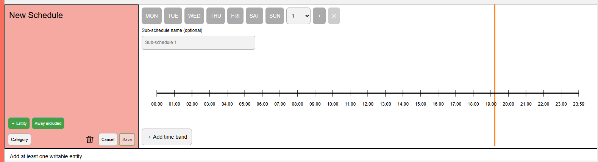
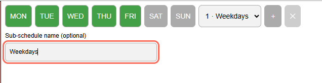
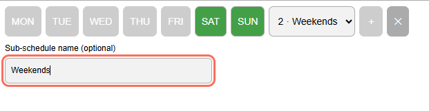
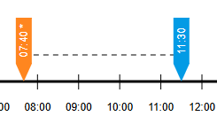
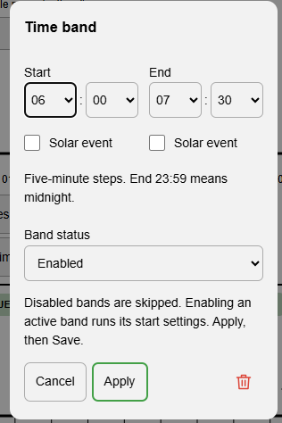
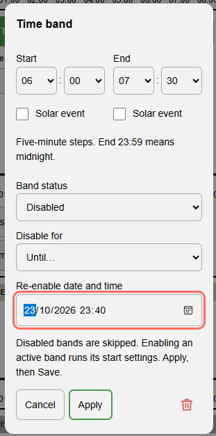
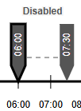
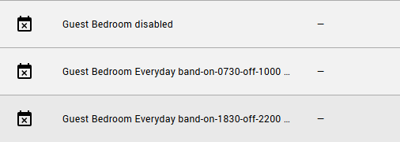
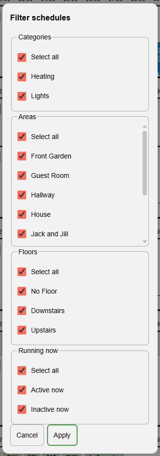

# Scheduling Manager

<a href="https://www.buymeacoffee.com/flatsheep"></a>

[](https://my.home-assistant.io/redirect/hacs_repository/?owner=flatsheep&repository=scheduling-manager&category=integration)

**A clearer way to manage your Home Assistant schedules.**

Scheduling Manager brings your Home Assistant schedules together in one clear,
interactive view. See what happens when, which devices each schedule controls,
and how your routines fit together. All on aligned timelines with a shared
current-time marker.

Plan your heating, hot water, lighting and other supported devices without
piecing together separate automations. Create a schedule, add its devices,
choose their start and end settings, then build your time bands visually. Use
a different routine every day, group days that share the same pattern, or
combine both.

Making adjustments is just as straightforward: drag time markers, enter exact
times, or tie an endpoint to sunrise, sunset and other solar events. Preview
another day with a tap, organise schedules into categories, and choose which
routines should pause when you're away.


## Features at a glance

- **Your routines, visible together.** Aligned timelines show multiple schedules
  on the same time axis, making morning, daytime and evening routines easy to
  compare. A single current-time line helps you see where you are in the day.

- **One schedule, multiple devices.** Bring related devices together and give
  each its own start and end settings, such as different temperatures for
  several rooms, or ON/OFF states for lights.

- **Flexible days and meaningful names.** Create named sub-schedules for
  individual days or groups of days. Give every day its own routine, or group
  days that share the same time bands. Tap a day in view mode to peek at its
  timetable.

- **Pause a band without changing the whole schedule.** Disable individual time
  bands permanently or until a chosen date and time. They stay visible in dark
  grey. Re-enabling a band during its active time applies its start settings,
  whether you enable it manually or let the timed disable expire.

- **Control schedules from your automations.** Read or change a schedule or
  band's disabled state through native Home Assistant switches or boolean path
  actions. A parent schedule can pause all its bands without losing their
  individual enable/disable choices.

- **Visual editing, with precision when you need it.** In edit mode,
  double-tap/click a blank part of the timeline to create a time band, or use
  **Add time band**. Drag fixed-time markers to adjust them, or enter exact
  times in the popup.

- **Follow the clock or the sun.** Use fixed times or solar events with offsets,
  independently at either end of a band. Start your outside lights at sunset
  and finish at a fixed bedtime, for example.

- **Find the schedules that matter.** Group schedules into collapsible
  categories such as Heating or Lights. Filter by category, Home Assistant
  area, floor or whether a schedule is active now.

- **Away mode that respects your choices.** Choose which schedules participate
  in Away. Pause those routines until you return, or set a date and time for
  automatic resumption, while excluded schedules carry on normally.

- **Make a manual adjustment without fighting the timetable.** Change a device
  setting when you need to. Scheduling Manager leaves that adjustment in place
  until the next relevant scheduled transition.

- **Keeps working when the dashboard is closed.** Scheduling runs inside Home
  Assistant, with saved schedules and recovery handling for restarts and
  temporarily unavailable devices.

**Start here:** [Install](#install) · [Create your first schedule](#create-your-first-schedule)
· [Solar time bands](#fixed-and-dynamic-time-band-endpoints)
· [Disable individual bands](#disable-an-individual-time-band)
· [Categories and filters](#categories-and-display-order) · [Away](#away)
· [Programmatic controls](#enable-and-disable-schedules-or-bands-from-automations)

## Compatibility

**Current versions:** card **1.11.0** / integration **1.11.0**.

A local, installable Home Assistant custom integration and dashboard card for **HA 2026.7 or later**. Tested releases: **2026.7.0**, **2026.8.1**, **2026.9.4** and **2026.10.1**. See [test results](TEST_RESULTS.md) for exact coverage and limitations; compatibility with later releases is not claimed.

The Python integration runs all scheduling with the dashboard closed. The companion TypeScript/Lit card edits private section drafts and uses HA's existing authenticated connection.

## Install

### Install with HACS

**One download installs both the scheduler and its matching dashboard card.**
The integration loads the card automatically, so you don't need to copy JavaScript
files, add a dashboard resource or write YAML.

**Availability:** install from this public repository using HACS's **Custom
repositories** option. It is not yet in HACS's default catalogue.

1. In **HACS**, open the **⋮ menu → Custom repositories**.
2. Add `https://github.com/flatsheep/scheduling-manager` and choose
   **Integration** as the category. You only need to do this once.
3. Search HACS for **Scheduling Manager** and select **Download**.
4. **Restart Home Assistant.**
5. Open **Settings → Devices & services → Add integration**, search for
   **Scheduling Manager**, and add it.
6. Create a dedicated dashboard view and select **Panel (single card)** as its
   view type. This is the recommended layout for the scheduler.
7. Choose **Add card → By card**, then search for and select
   **Scheduling Manager**. If it is not listed yet, refresh the browser or
   reopen the companion app and try again.
8. Choose **＋ Schedule** and start building your first routine.

You can also use [this shortcut to add the repository to HACS](https://my.home-assistant.io/redirect/hacs_repository/?owner=flatsheep&repository=scheduling-manager&category=integration).

### Install without HACS

1. Download **scheduling-manager-1.11.0.zip** from the
   [v1.11.0 release](https://github.com/flatsheep/scheduling-manager/releases/tag/v1.11.0).
2. Extract its `custom_components/heating_schedule_manager/` folder into your
   Home Assistant configuration's `custom_components/` directory. Create the
   `custom_components` directory if it does not exist.
3. **Restart Home Assistant.**
4. Add **Scheduling Manager** under **Settings → Devices & services → Add
   integration**, then add its card to a dashboard as described above.

The ZIP includes the built card and license notices. No build tools or separate
dashboard resource are needed. For manual updates, replace the integration folder
with the new release's folder, restart HA and refresh your dashboard. Keep your
existing integration and schedules.

### Recommended dashboard layout: Panel (single card)

Give Scheduling Manager its own **Panel (single card)** view. This lets the
card use the full available width, making the aligned timelines and device
settings easier to see and edit together.

1. Edit your dashboard and **add a new view**.
2. Give the view a title, such as **Scheduling Manager**, and choose
   **Panel (single card)** under **View type**. Save the view.
3. Add the **Scheduling Manager** card as that view's single card, then save
   and leave dashboard editing.

The card uses the view's title as its heading. Panel is recommended rather
than required; you can also use the card in other dashboard layouts.

### Updates

Download updates through **HACS**, restart Home Assistant, then refresh your
dashboard. The integration and card are updated together, and your saved
schedules are retained.

<details>
<summary>Moving from an older manual installation</summary>

Install through HACS and restart HA; keep the existing Scheduling Manager
integration and dashboard card. Do not delete/re-add the integration or remove
its saved schedules.

Remove the old **scheduler-only** resource from **Settings → Dashboards →
Resources** if you previously registered `/local/scheduling-manager-card.js`
or `/local/heating-schedule-manager-card.js`. The new integration loads its
bundled card automatically. Leave unrelated resources alone, then refresh
the browser or reopen the app. Existing card type aliases remain supported.

</details>

<details>
<summary>YAML-managed dashboards</summary>

For a YAML-managed dashboard, the card type is:

```yaml
type: custom:scheduling-manager-card
```

The card is loaded automatically in YAML mode too; no resource entry is needed.

</details>

### Remove

Open **Settings → Devices & services → Integrations → Scheduling Manager**,
then use the configuration entry's menu to **Delete** it. This stops scheduling
and removes its associated entities without changing device settings. Its
automatically registered frontend module is removed too. Remove the dashboard
card, then uninstall the package through **HACS** to remove its files.
Saved schedules are deliberately retained for recovery if the integration is
added again; deleting the entry is not a factory reset. See
[Removal and recovery](HA_STANDARDS.md#removal-and-recovery) for permanent data
removal instructions.

### Publication status

The HACS package includes the integration, built card, license notices and brand
icon. The repository is public and HACS repository validation has passed. See
[HACS publication preparation](HACS_PUBLISHING.md) for validation and release
status. Public custom-repository installation and inclusion in HACS's default
catalogue are separate steps.

The card heading derives from the **containing dashboard view's Title**. An untitled view leaves it blank. A legacy card-level `title` is ignored; no fallback title is inserted.

### Compatible rename

The integration's internal domain, config-entry identity, storage key, WebSocket namespace and Away unique/entity ID remain `heating_schedule_manager` / `switch.heating_schedule_away` for compatibility with saved schedules and automations. Keep the installation folder `custom_components/heating_schedule_manager/` as shown above. Existing `custom:heating-schedule-manager-card` cards remain supported by the bundled compatibility alias; new configurations should use `custom:scheduling-manager-card`.

## Create your first schedule

### 1. Add and name a schedule

Use **＋ Schedule** in the header. The other header controls collapse/expand
categories (**Hide all / Show all**), open **Filter**, and control **Away**.


A new schedule opens in edit mode. Tap or click **New Schedule** in the left
panel to give it a meaningful name, such as *Heating* or *Outside lights*.
The timetable starts empty; Save remains disabled until the schedule is valid.



### 2. Add entities and choose their start/end settings

Choose **＋ Entity**, search for a supported writable entity, and confirm its
settings. Repeat to add more entities to the same schedule.


For thermostats, **orange on the left is the start target** and **blue on the
right is the end setback**. In this example, Lounge receives 21°C at a band's
start and 13°C at its end. Tap a value while editing to change it. A thermostat's
setback is shared across its schedules; its orange target is specific to each
schedule.

For other supported entities, the same positions hold start/end states or
values, for example **ON → light → OFF**. The small trash control removes an
entity from the draft; it takes effect only when you save.

### 3. Group days into named sub-schedules

Select one day or a group of days that should share a timetable. Selected days
turn green. Give the group an optional, logical **Sub-schedule name**, such as
*Weekdays*, *Weekends* or *Monday*. Each sub-schedule has its own time bands;
all of its selected days use those same bands.

| Weekday routine | Weekend routine |
| --- | --- |
|  |  |

For example, to give weekends different times, use the **＋ beside the sub-schedule
dropdown**, select Saturday and Sunday, and optionally name that group
*Weekends*. Switch between the groups using the dropdown, then add time bands
for each. Alternatively, create a separate sub-schedule for every day, each
with its own logical name and up to ten time bands. Days already assigned to
another group cannot be selected until released from that group. You can have
up to seven sub-schedules, provided each has its own days.

After saving, tap a day in view mode to peek at its sub-schedule. Previewing
does not edit the timetable or command devices; see
[day previews](#preview-another-days-routine).

### 4. Add time bands

In **edit mode**, double-tap/click a blank part of the timeline to create a
one-hour band where there is room. Alternatively, choose **＋ Add time band**,
set the Start and End in the popup, then press **Apply**. Repeat for additional
periods, such as morning, afternoon and evening. Each sub-schedule can have
up to ten bands.



The **orange marker** issues the start/target settings; the **blue marker**
issues the end/setback settings. The dashed line connects the pair. A `*`
beside a time identifies a solar endpoint, whose resolved time changes with
the date.

While editing, tap a band or marker to edit its times, or drag a fixed-time
marker in five-minute steps. Solar endpoints are changed through the popup.
For an overnight period, create a band to the end of one day and another from
the start of the next; **23:59 as an End means following midnight**.

See [fixed and dynamic time bands](#fixed-and-dynamic-time-band-endpoints)
for sunrise/sunset settings and offsets.

### Disable an individual time band

In schedule edit mode, open the time-band popup and set **Band status** to
**Disabled**. Choose **Permanent** or **Until…** with a date and time in
Home Assistant's timezone. Press **Apply**, then **Save** the schedule.

| Enabled band | Disabled until a date and time |
| --- | --- |
|  |  |

- The band stays visible in dark grey with a **Disabled** label. Its start and
  end transitions are ignored while disabled; other enabled bands keep working.
- Disabling an active band leaves device settings unchanged. It does not apply
  the band's end settings.
- A timed disable survives Home Assistant restarts. At expiry, an active band
  automatically applies its saved start settings. Outside the band's active time,
  it simply restores future transitions. Its later end transition runs normally.
- To restore a disabled band manually, choose **Enabled** in **Band status**,
  then press **Apply** and **Save**. If the band is active when saved, its start
  settings are applied. Otherwise, it waits for its next scheduled transition.
- Enable and disable changes stay in the draft until Save. Cancel discards them.
  Manual enabling and timed expiry respect schedule-level disable and applicable
  Away.
- A band belongs to its sub-schedule, so disabling it affects all weekdays in
  that group. Its saved times still reserve their place in the editor.

This is separate from the schedule-level **Enable/Disable** control. A disabled
schedule or applicable Away mode still suspends its bands, even after a band's
timed disable expires.



### 5. Choose a category and Away participation

Use **Category** to group related schedules, for example *Heating* or *Lights*.
Use **Away included / Away excluded** to choose whether the global Away
control affects this schedule. Included schedules have their normal transitions
suspended until you turn Away off or its chosen return date/time is reached;
excluded schedules continue normally. These choices are part of the draft until
you save. See [Away](#away) for its device-setting behaviour.


### 6. Save and use the timetable

Press **Save** after every retained sub-schedule has selected days and at least
one band, and the schedule has at least one entity. **Apply** in a popup updates
the draft; **Save** commits the schedule. **Cancel** discards the draft after
confirmation. Use the cog beside the schedule's name to edit it again.

Once saved, the backend runs the timetable even with the dashboard closed.
Saving changes future events; it does **not** immediately replay the start of
a band already in progress. Manual device adjustments remain until the next
applicable transition. **Enable/Disable** and **Away** are explicit controls
with their own immediate behaviour, described below.

## Temperature behaviour (important)

- **Every applicable climate endpoint issues a temperature command**, even when the last scheduler command had the same value. Starts use each membership's orange target; ends use that entity's blue shared setback.
- The **last executed command wins** for an entity that appears in several sections. The card's dashed band is a timetable, not continuous ownership of the thermostat. A section can issue setback while another section's band remains active.
- Manual thermostat changes remain until the **next transition affecting that entity**. There is no enforcement loop, persistent manual mode or Resume button.
- **No Schedule issues no command.** It leaves the temperature unchanged. Midnight does not synthesize setback; yesterday's genuine end-of-day endpoint can still fire then.
- **Save changes future events.** It does not replay historical endpoints or assert the current band's target. Values changed during a band take effect at subsequent transitions. An endpoint exactly at the commit boundary runs only if it has not already been processed.
- Removing an entity or section cancels its future events and leaves its current temperature alone.
- For **climate entities**, only `climate.set_temperature`, with `entity_id` and single `temperature`, is called. Their HVAC modes, presets and on/off state are not changed. Other entities use their real state-setting actions.

### Shared setback and per-section target

Each distinct climate entity has **one shared setback** throughout the manager. Blue edits include a reminder of this. Saving updates every saved representation of the entity; cancelling changes nothing. Orange targets remain separate per entity **within each section**. Targets need not exceed setbacks. Duplicate section names are allowed; stable UUIDs identify objects.

### Writable state entities

Sections can mix climate and other commandable entities. For **non-climate memberships**, the orange start-state and blue end-state are both **per schedule**. Either direction is allowed: a light can start OFF and end ON, or start ON and end OFF. A second section can choose a different pair for the same entity. Every unsuspended endpoint issues its action; manual changes remain until the next applicable transition.

The picker only shows supported writable choices. Sensors/read-only entities, stateless press/activate-only entities and the manager's own Away control are excluded. Choices come from real registered HA actions, advertised options and supported features, not from state history or fake state injection.

| Entity types | Supported state/value controls |
|---|---|
| Light, switch, input boolean, automation, script, remote, humidifier | ON/OFF |
| Fan, siren | Advertised ON/OFF features |
| Cover, valve; lock | OPEN/CLOSED; LOCKED/UNLOCKED |
| Select, input select; water heater | Advertised options; operation modes |
| Number, input number | Numeric values constrained by advertised min/max/step |
| Text, input text | String values constrained by length/pattern |
| Date, time, datetime, input datetime | Date/time value editors; datetimes use HA timezone |
| Media player | Advertised play/pause/stop/off states |
| Vacuum, lawn mower | Advertised cleaning/mowing, docking, pause/stop states |
| Timer | ACTIVE/PAUSED/IDLE |
| Classic group of supported binary devices | ON/OFF through HA's group-expanding actions |
| Alarm control panel | Advertised arm/disarm choices that do not require an undisclosed code |

Groups containing read-only entities, climate devices or this manager's control are excluded. Unsupported custom setter types are not listed. Only the advertised real action is invoked; HA acceptance is not proof of physical state achievement. Number values retain their declared units; a unit change requires reselecting values instead of silently reinterpreting them.

### Enable / Disable a section

In view mode, each section has a **grey Disable** button while enabled and a **green Enable** button while disabled. These controls are immediate, administrator-only actions whose state is persisted and shared across clients.

- **Disable** immediately applies climate setback, leaves non-climate states unchanged, cancels that section's pending state work and suspends future transitions. Another section can still command a shared entity; last command wins.
- **Enable** applies climate targets and non-climate start-states if a band is active. Outside a band (including No Schedule), it applies climate setback and leaves non-climate entities unchanged. Future transitions resume without replaying historical state endpoints.

Enable/Disable skips already-correct thermostat targets, including a fresh check at delivery. The card acknowledges the durably saved flag before necessary serialized background device updates, with **Updating devices…** feedback. Disable does not replay its own overdue starts before applying setback. Storage failure leaves the saved flag unchanged; pending needed work survives restart. Regular timed endpoints retain their usual command semantics.
- Away suspends normal transitions in **Away included** sections. Entering applies climate setbacks where needed; excluded sections operate normally.
- The controls do not appear while that section is being edited. A toggle in another section can make unsaved edits stale, just like Away or another client's Save.
- Existing 1.0.0 sections without an `enabled` field load as enabled. This is a backward-compatible schema-1 extension; existing memberships, temperatures and bands remain intact.

The automatic **No Schedule** display still sends nothing; pressing Enable is an explicit action with the immediate behaviour above.

### Away

The header and Away switch control the same persisted global flag. Green means active. The section editor's **Away included / Away excluded** toggle is committed on Save; existing sections default to included. Participating view timelines show **Away**, while excluded sections retain their ordinary timeline and transitions.

Pressing **Away** opens a popup: **Now** (until I turn it off) or **Until…** (return automatically). Both start Away immediately. Until requests a date/time in **HA's timezone**, not the phone/PC timezone. Enable Away commits; Cancel sends no write. While active, the popup can update the deadline, make Away indefinite or **Turn Away off**. The timed return appears beside the header button.

The optional `away_until` timestamp is stored in UTC, retaining schema/storage version 1, and uses the backend's one-shot timer. It survives dashboard closure and restarts. If it expired while HA was offline, startup disables Away and coalesces normal progress after the cutover without replaying stale setbacks or state starts. Manual off clears the timer; changing only the deadline preserves history and issues no device action. External switch on starts indefinite Away when off and preserves an existing timer when already on.

Past/invalid dates and missing local DST-gap times are rejected. Ambiguous fall-back times use the earliest future occurrence. Saved UTC deadlines do not shift on timezone changes. Diagnostics redact the return date.

Entering Away applies setback only to participating climate entities whose current target needs changing. Already-correct targets are not resent. While Away, **all included normal transitions are suspended**: there are no repeated setback commands. Non-climate entities retain their state; excluded sections continue normal dispatch. Repeated requests for the saved global flag are idempotent. Unknown/unavailable targets keep needed pending work for recovery, with a fresh equality check before delivery.

Leaving Away applies start targets/states **only for currently active participating schedules**. Inactive/disabled schedules leave devices at setback; historical targets are not restored. For a shared entity, the last active schedule in saved order supplies the final target. Already-correct climate targets are skipped. Normal non-Away endpoints retain their usual command semantics. New participating climate memberships/changed setbacks while Away apply only needed setback changes.

The card acknowledges Away after its mode/timer are durably saved, then queued device work finishes under the existing serialized journal lock. The popup shows saving/resuming feedback; **Updating devices…** appears while delivery remains pending. Device errors remain visible in runtime status. No optimistic change is accepted before persistence.

Away is a global operation outside section drafts; **Cancel does not undo an Away toggle**. Because version 1 uses a global revision, toggling Away or saving an unrelated section can make another draft stale. The card keeps that draft visible, reports the conflict, and allows inspection before Cancel/discard and reopen.

Automations can use ordinary HA switch actions:
```yaml
action: switch.turn_on
target:
  entity_id: switch.heating_schedule_away
```
`switch.turn_off` exits Away. Dashboard/API mutations and user-context switch calls require an administrator. HA's internal automation calls without a user context are supported.

### Schedule entities

Every saved schedule is exposed as a read-only `binary_sensor` with a stable UUID-based identity. Its state is `on` only while the schedule is enabled, inside a resolved time band and not suspended by Away. Creating, editing or deleting a schedule adds, updates or removes its matching entity. Its attributes expose the schedule ID, current name/category, enabled and Away state, member actions, weekday/band definitions (including solar endpoints) and the next scheduled endpoint. These attributes make the saved schedules available to ordinary Home Assistant state consumers, including compatible MCP clients; they do not provide schedule-editing controls.

### Enable and disable schedules or bands from automations

Each schedule and time band has a **Disabled** switch. **On disables; off
enables.** Use these switches in Home Assistant automations and scripts. There is
no switch for a sub-schedule.



| Control | Example entity ID | Turn on | Turn off |
| --- | --- | --- | --- |
| Schedule | `switch.schedule_manager_schedule1_disabled` | Disable the schedule | Enable it |
| Band | `switch.schedule_manager_schedule1_weekdays_band_on_0700_off_1000_disabled` | Disable this band | Enable it |

Switch entity IDs are assigned by Home Assistant and can be renamed. Find the
current IDs under **Settings → Devices & services → Entities**, or read the
`path` attribute and use the programmatic actions below. The dotted paths are API
identifiers, not HA entity IDs.

Each switch also works with ordinary HA actions:

```yaml
action: switch.turn_on
target:
  entity_id: switch.schedule_manager_schedule1_weekdays_band_on_0700_off_1000_disabled
```

#### Read and set the boolean path

Paths follow schedule names, sub-schedule names and band times. They are useful
when reading or setting a control without looking up its switch entity ID.

```yaml
action: heating_schedule_manager.get_disabled
data: {}
response_variable: controls
```

This returns readable schedule and band paths in `controls.controls`. Read one
path with `path` supplied:

```yaml
action: heating_schedule_manager.get_disabled
data:
  path: schedule_manager.schedule1.weekdays.band-on-0700-off-1000.disabled
response_variable: band_status
```

The returned `band_status.disabled` is a boolean. Set a path by sending a boolean:

```yaml
action: heating_schedule_manager.set_disabled
data:
  path: schedule_manager.schedule1.weekdays.band-on-0700-off-1000.disabled
  disabled: false
```

- `disabled: true` disables permanently. `false` enables immediately and cancels
  any timed disable. If the band is active, its start settings are applied;
  otherwise it waits for its next scheduled transition.
- A disabled parent makes each band report `disabled: true`, while preserving its
  `own_disabled` value. Re-enabling the parent does not enable its disabled bands.
- Enabling a band under a disabled parent clears that band's own Disabled value,
  but leaves the parent disabled and sends no device command.
- Away is separate. Read `suspended_by_away`; applicable Away still suspends normal
  scheduling even when the parent and band are enabled.
- Paths are normalized to lowercase underscores and follow renames or time edits.
  Duplicate names get UUID suffixes. Unnamed sub-schedules use `sub_schedule_1`,
  and solar bands use their event and offset in the band name. Discover current
  paths instead of guessing when names collide.
- Writes update saved state immediately and can make an open card draft stale.
  User-context writes require an administrator. Home Assistant automation calls
  without a user context are supported.

## Editing and timeline controls

### Fixed and dynamic time-band endpoints

To use a solar time, open the time-band editor, tick **Solar event** for Start
or End, choose an event, and set an offset in minutes. A negative offset is
before the event; a positive offset is after it. The other endpoint can remain
a fixed clock time.


In this example, the band starts at **sunrise** with no offset and ends at
**08:00**. The preview shows sunrise at **07:40 on the displayed date**; it is
not a fixed daily start time. Press **Apply**, then **Save** the schedule.

The time-band popup uses separate **hour and minute selectors** for fixed Start/End times. Minute choices are 00, 05, 10, …, 55, including on iPhones whose native time wheel ignores the HTML step setting. End at hour 23 also offers 59 for the special following-midnight endpoint. A resolved solar clamp can display its exact off-grid minute.

Each endpoint has its own **Solar event** checkbox. Checking it hides the fixed-time picker and shows a dropdown with **Sunrise, Sunset, Dawn, Dusk, Solar noon, Solar midnight**, plus an integer **Offset (minutes)** defaulting to 0 and limited to **−300 through +300**. These are HA's real solar calculations for its configured latitude, longitude, elevation and timezone; no sun entity is required. Dawn/dusk use HA's civil-twilight calculation. Solar midnight is the sun's daily low point, not necessarily clock midnight.

The event dropdown replaces the fixed-time picker in the same Start/End position. Beneath the offset, the predicted time shows **the solar event plus its offset**, updating immediately as that event or offset changes. If this differs from the day/pair-clamped endpoint, a separate **Band time** shows the time that will appear on the timeline. Predictions across midnight identify the previous/next day. A date below the controls identifies the calculation day; an absent solar event displays Unavailable. These previews remain local until Apply and section Save.

Dynamic configuration is available only in this popup: open it with **Add time band**, tap/click a band or marker in edit mode, or double-click a blank gap to create a band and then tap/click that band. Only the solar endpoint is locked against dragging/arrow keys. Its paired fixed endpoint remains adjustable, bounded by the resolved solar endpoint. Use the popup to change a solar event or offset. Popup Cancel discards endpoint changes; Apply changes only the section draft, and section Save commits it.

The backend recalculates solar endpoints for each scheduled local date, independently of the dashboard. Solar minutes are not snapped to the five-minute grid. Timeline labels append **` *`** only to dynamic endpoints, with no legend. View mode shows today's values; a preview uses the next occurrence of the tapped weekday, and editing a group without today uses its next first assigned weekday.

Resolved endpoints are clipped to 00:00–following midnight. **Start is the anchor:** whenever resolved Start is later than End, End matches Start, whether either endpoint is fixed or dynamic. In the popup, a fixed End's **selectors themselves update** to the adjusted time, its minimum follows Start, and earlier choices clamp immediately. Solar minute precision is retained even when Start falls between five-minute fixed times. An adjusted End Band time and **End matches start** identify an earlier requested anchor. Endpoints never swap; a collapsed dynamic band has no active interval and issues only its end action at the common Start instant. Fixed-only bands remain nonoverlapping and retain their five-minute minimum duration; their popup End minimum is Start plus five minutes. Solar-driven bands may overlap other bands as dates change, with ordinary last-executed-command-wins semantics. If a solar event does not occur on that date (for example polar sunrise), the band issues no action that day rather than using a made-up fallback; its unavailable timeline label remains editable.

### Categories and display order

Solar neighbours wholly before/after the band's stored endpoints provide resolved drag/arrow-key boundaries, including offsets. Five-minute snapping rounds inward. Only solar endpoints are non-draggable; mixed bands keep their fixed endpoint adjustable.

In section edit mode, **Category** lets you assign an existing category, create a new one, or choose **Unassigned**. Assignments are private edits until section Save; Cancel discards them. Names are trimmed and case-sensitive. Category names are derived from saved assignments rather than a separate registry: removing or deleting the final assigned section removes that category automatically. Existing sections default to unassigned.


Choose the category, press **Apply**, then **Save** the schedule. Categories
create collapsible groups in the main view; they do not change which schedule
wins when more than one commands the same entity.

The header's **Filter** control offers Categories, Areas, Floors and **Active now / Inactive now**. Each dimension supports multiple checkbox choices and Select all/mixed state. Choices within a dimension are ORed; dimensions are combined with AND. Area/Floor matching uses linked entities: an entity Area overrides its device Area, and Floor comes from that Area. At least one member must match both selected Area and Floor. No Area/No Floor are offered for unassigned memberships. These are live HA registry metadata, not additional saved schedule assignments.

<details>
<summary>Show the Filter popup</summary>



</details>

For example, select **Heating** under Categories and **Downstairs** under
Floors to show heating schedules with a matching downstairs entity. Add
**Active now** under Running now to narrow that view to currently active
schedules. Clear other selections in each of those dimensions as needed;
leaving **Select all** selected does not narrow that dimension.

Press **Apply** to change your view or **Cancel** to leave it alone. A green
Filter button and red **✕** indicate applied filters; use **✕** to clear them.
Filtering hides rows locally. It does not disable schedules or change device
settings.

**Active now** is authoritative backend time-band activity: the current resolved, non-collapsed band is running, the schedule is enabled, and normal execution is not suspended by its Away participation. Merely being enabled, a thermostat reporting heating, or showing a preview does not imply activity. The predicate uses the scheduler's UTC/DST rules. Apply changes only local presentation; Cancel retains prior filters. The green Filter button and red X identify/reset applied filters. The open editor is retained when excluded. The sort feature is removed.

Schedules are grouped by category in expandable accordions, including Unassigned. Category order follows its first saved occurrence, and schedules inside each group retain saved order; grouping never changes execution precedence. The category name is right-justified, the running count left-justified. Zero-running groups are grey; groups with running schedules are very light green. Tap the header/up/down arrow to toggle it, or use **Hide all / Show all** in the main header. Empty filtered groups disappear. Collapsing keeps drafts intact and hides the shared-time line when no schedule rows are shown.

Entity lists retain two columns. Up to **six entities (three rows)** are visible before vertical scrolling; larger lists provide a scrollbar, keyboard-focusable viewport and explicit up/down controls. The first six rows' height is measured so long entity names remain readable. Mouse, touch and keyboard scrolling do not enlarge the timetable or issue device commands.

Entity rows now read **orange start/target → entity name → blue end/setback**, matching the timeline's start/end direction.

#### Preview another day's routine


In view mode, the current day's group is light green and other scheduled days
are grey. Tap a grey day to preview its timetable without changing saved
schedules or issuing device commands. The preview uses a dotted overlay and
blue borders for its linked days. Tap the current green day, the same preview
day again, or the background to return; it also closes after ten seconds.
The named badge can open the other sub-schedules in a compact chooser.

#### Editing and interaction reference

- The **cog** opens the section editor. Tap the prominent name box to rename; **＋ Entity** opens the searchable writable-entity picker. Edits stay local until Save.
- In edit mode, the outlined section trash icon sits immediately left of **Cancel**. Each membership has its own smaller trash icon. Entities remain paired in two columns; **＋ Entity** and **Away included/excluded** sit above the Category / Delete / Cancel / Save row. Icons have accessible names and do not rely on an OS emoji font.
- View badges show **all seven weekdays**. Current grouped days are light green; other scheduled days are grey; unassigned days are white with black borders and do nothing when pressed. A grey-day preview adds a full-strength dotted ghost over the dimmed current timeline and blue borders to **every linked day**. Clicking the card/timeline background, a green current day, the selected preview day again, or Escape dismisses it. Selecting another grey day switches the preview and restarts its **10-second timeout**; pointer movement does not restart it. Previewing never changes saved configuration or issues device commands. No Schedule, Away and Disabled status remains visible in very light grey during a preview.
- Optional sub-schedule names appear as **1 · Weekdays** in a rounded rectangle beside the days; unnamed schedules keep a number circle. The current badge is light green and the preview badge grey. Tapping the badge opens the other sub-schedules **directly underneath as an overlay**, without moving the timeline. The list is constrained to the card/viewport and scrolls for longer lists. Choosing the current entry returns to it. The timeout pauses while the chooser is open and restarts on closure/selection.
- Red removal controls open explicit **Yes / No** confirmation. Section, membership, sub-schedule and band deletions remain draft changes. Save commits; Cancel discards with a confirmation. Pending section deletion keeps Save/Cancel visible.
- Climate temperature controls retain supported increments/limits and shared setback. Non-climate controls edit the section's end/start pair through option dropdowns or type-appropriate inputs. First assignment requires confirming the pair, and editor capabilities are refreshed when opened.
- Green weekday buttons share a timeline. Grey unselected days can be chosen unless assigned to a different sub-schedule in that section; their tooltips identify the owner. Other sections can use the same days freely.
- The editor dropdown chooses a sub-schedule, using its number and optional name; each new edit begins at 1. Names are optional, trimmed on Save, and removing the name restores number-only display. Name-only edits preserve runtime history, pending commands and Away restoration. The adjacent **＋** adds a sub-schedule, up to seven and only when a weekday is free. The last retained sub-schedule cannot be deleted.
- Hold a **blank gap** for about **600 ms** to propose a one-hour band. Movement beyond 8 pixels or touch scrolling cancels creation. Rounding ties go toward the **later** five-minute time. If a full hour will not fit, an exact-time form asks for an explicitly shorter free interval; nothing is silently shortened.
- Double-click a blank part of the editable timeline to create the same one-hour band immediately **without a popup**. Band interiors and marker hit areas do not count as blank. If an hour does not fit or the ten-band limit is reached, creation is refused inline; use Add time band for an explicit interval instead.
- Drag endpoints with five-minute snapping/clamping to their neighbour and paired endpoint. Touching bands are allowed; crossing and overlap are prevented. Marker bodies are offset at shared timestamps without changing their semantic times. Very short bands use staggered marker bodies.
- Overlapping marker taps/clicks bring a marker to the foreground; repeated clicks within the shared hit area alternate selection. This works in view and edit modes and changes only display layering. In edit mode, use **Edit times** for the selected band's exact-time form or **Delete band…** for confirmation. Their layout space is reserved so selecting an overlap does not move the markers under the pointer. Non-overlapping markers retain tap-to-edit and double-tap-to-delete. Keyboard **Enter**, **Delete** and **Left/Right** remain available; **Add time band** is the gesture-free creation alternative.
- There are at most ten bands **per sub-schedule**. Overnight periods need separate daily bands.
- The far-right **23:59** means **following midnight** internally (`1440`), not a one-minute gap. Enter 23:59 as an end time for this special endpoint.
- On phones, each timeline is horizontally scrollable with a minimum 900px canvas. Exact-time forms make five-minute selection practical without relying on tiny touch movements. Hourly ticks remain; mobile labels are less dense. Time and weekday use **HA's timezone**, not the phone's, and refresh at least every 30 seconds and on tab resume.
- A red **✕** immediately left of Filter appears while any dimension is filtered. It clears all presentation filters in one action and issues no backend write.
- Header, section outlines and surfaces follow HA's theme. Entity names use compact 16px text, and Cancel precedes Save. A **single current-time box and orange line** spans all displayed schedule strips. Timeline scrolling is synchronized to keep their axes aligned; width changes keep current time visible. Current time is based on HA timezone and is not duplicated per row. The SVG axes and marker text retain constant proportions while resizing.
- Touch interactions on the timeline suppress the native context menu and text selection/callouts. Edit markers retain touch-action suppression, stable SVG pointer capture and five-minute snapping for held monitor-touchscreen dragging.
- Popups use control-appropriate compact widths. The time-band editor is 300px wide with paired Start/End fields, room below the help text and an outlined trash icon in the lower-right footer. No retains the editor; Yes removes the band from unsaved edits. Add time band has clearance above the strip's bottom divider.

### Reference layout · card 1.4.1

During preview, No Schedule retains its normal position, size and spacing; only its colour changes to very light grey. The preview timeline overlays the existing status area without shifting the label or resizing its strip.

The view title and day box share the theme-coloured toolbar. Each desktop strip has a 354px schedule panel beside its timeline: a pale shade derived by mixing 55% of HA's header/theme colour with the card background, a plain prominent schedule name with inline controls, and two compact entity columns. Thin theme-aware dark outlines and divider rules follow the supplied reference. The timeline remains on the card surface, with allocated-day badges and the category label behind it. A single time box sits above the first timeline's markers and its line continues across the strips.

Desktop axes fit a minimum 600px canvas, with smaller hour labels where needed. Phones stack the tinted panel above the timeline, retain paired entity rows where space permits, and use the 900px scrollable canvas and exact-time forms. SVG text/markers remain proportionate; no whole-SVG horizontal stretching is used. The tint can be overridden through the CSS variable `--schedule-panel-background`.

## Persistence, recovery and failures

The manager uses one versioned HA `Store` snapshot at `.storage/heating_schedule_manager`, containing configuration, revision, cached capabilities and the runtime journal. Writes use HA's atomic storage API. It participates in ordinary HA backups. A read-only preflight rejects corrupt JSON/invalid envelopes before HA's default corrupt-store recovery can rename or replace the original; setup reports an error and the existing file is preserved.

Configuration mutations and timed dispatch share a lock. Old callbacks carry a generation token; unload cancels timers/subscriptions and waits for in-flight dispatch. Commands are serial (including commands for the same entity), with a 20-second service-call timeout; a failing entity does not abort later healthy entities.

On restart with no missed endpoint, temperatures are not reasserted. Missed transitions are reduced to one final desired command per affected entity. Weekly recurrence makes long downtime bounded: at most eight recent originating days need compilation. Pending desired work is journalled before dispatch; accepted service calls are acknowledged durably. Clock rollback does not replay processed dates. All runtime and configuration changes are generation-linked by the single atomic snapshot.

Execution-changing Saves preserve unrelated overdue transitions in the same atomic commit, while the edited section retains its no-retroactive-start cutover. Dispatch validates fresh capabilities through direct entity lookups; whole-HA discovery is reserved for the editor catalog. Only referenced entities' supported metadata is durably cached, including unavailable entities' last valid metadata. Notifications are coalesced and unrelated current-value updates do not redraw the card. Per-command acknowledgements remain durable and serial to retain the existing crash-replay bound.

Unavailable/missing devices keep their newest pending command, replaced by subsequent endpoints. Availability recovery sends only that pending value. Recovery with nothing pending sends nothing. Failures and unsupported values appear in the card and HA integration diagnostics. A failed command is tried on a new transition, on availability recovery, or once at startup if a pending entity is already available; there is **no periodic retry/enforcement loop**. Observed manual changes cancel failed pending work, and the integration's own command contexts are excluded from that detection.

Service acceptance means **HA accepted the action**, not proof of heating output or physical acknowledgement. Exactly-once physical delivery across a crash is impossible: a successful action followed by a crash before durable acknowledgement can be repeated during recovery.

### Timezone and DST

Events use local calendar definitions and timezone-aware UTC timers. Europe/London spring gaps map nonexistent endpoints to the first valid minute after the gap; logical endpoint order is retained and collapsed physical effects are coalesced. Repeated autumn endpoints execute once at the first occurrence. A timezone change retains the saved weekdays/times, establishes a new cutover and rebuilds future timers without replaying historical events.

The stable internal ordering is UTC instant, logical local time, end-before-start at a shared wall timestamp, then persisted section/band order. Thus adjacent end/start pairs and yesterday's 1440/today's 00:00 leave the starting target applied. This is diagnostic internal ordering, not a user priority feature.

### Device capabilities and units

Single-target climate devices (`ClimateEntityFeature.TARGET_TEMPERATURE`) are supported. Range-only devices are shown as unsupported rather than receiving invented low/high targets. Saved unavailable devices remain editable using last supported cached limits and increments. Dispatch always revalidates current feature flags, limits and steps; a mode change cannot force the manager to change mode.

Temperature values retain their explicit °C/°F unit. HA's `TemperatureConverter` converts them to HA's configured service units. Decimal validation uses the step grid anchored at the advertised minimum; out-of-range or off-grid conversions require correction instead of silent rounding. HA's climate helper does **not** advertise a universal target step when an entity omits it. The fallback is HA's default display precision: **0.1°C / 1°F**, not a universal 0.5 increment. Devices with undocumented coarser increments may reject commands; configure values that the device accepts and surface the failure rather than changing its mode.

Entity-registry UUIDs track renames when available. Registry-less entities are also supported, but their ID changes need removing/re-adding the membership.

## Development transparency

This project was **vibe coded: developed with substantial AI assistance using
OpenCode**. The maintainer directed the requirements, interface design and
scheduling behaviour, while AI coding tools helped write and revise the
backend, frontend, tests and documentation through iterative development.

Verification includes automated backend tests, frontend unit and browser tests,
Home Assistant integration validation, and use in a real HA installation.
See [test results](TEST_RESULTS.md) for the checks performed, versions tested
and remaining limitations.

## Development and verification

Release 1.7.0 modernizes runtime ownership, naming/translations, push-only Away updates, setup/Repairs errors, diagnostics and automated checks. See [HA standards alignment](HA_STANDARDS.md) for verification, removal/recovery instructions and remaining publication/strict-typing work. This remains a custom integration without an official quality-tier assignment.

Source is under `custom_components/`, `frontend/src/`, and `tests/`. The build
copies the card into both `dist/` and the integration's `www/` directory, and
includes its license notices in the integration. HACS installs the complete
application from that integration directory. The module bundles Lit and needs
no runtime CDN dependencies. The npm lockfile pins dependencies; CI checks that
the committed HACS bundle matches the source build.

Build with Node.js 20.19+ and npm:
```bash
cd frontend
npm ci
npm run build
npm test
npx playwright install chromium
npm run test:browser
```

The browser fixture serves only a **mocked** dashboard on loopback; its test API never contacts HA. It produces screenshots in `artifacts/`.

Backend tests run in the actual release images, with an isolated temporary configuration, **no network**, and mocked climate entities/actions. From the project root:
```bash
docker run --rm --network none --entrypoint python \
  -v "$PWD:/work:ro" -w /work \
  ghcr.io/home-assistant/home-assistant:2026.7.0 \
  tools/check_backend.py

docker run --rm --network none --entrypoint python \
  -v "$PWD:/work:ro" -w /work \
  ghcr.io/home-assistant/home-assistant:2026.9.4 \
  tools/check_backend.py

python3 tools/package.py
```

For isolated scheduler overhead measurements, use the same read-only, network-disabled HA container and run `python tools/benchmark_scheduler.py`. It creates a temporary HA configuration and uses synthetic states and mocked services. See [test results](TEST_RESULTS.md) for historical measurements.

See [API contracts](API.md) and [test results and boundaries](TEST_RESULTS.md).
Browser tests generate desktop and phone screenshots locally in `artifacts/`;
local artifacts and installation records are excluded from the repository.
The selected documentation screenshots supplied by the maintainer are kept
separately in `docs/images/` and included with the manual installation archive.

## License

Scheduling Manager is licensed under the **GNU General Public License v3.0**.
See `LICENSE`. The bundled card includes Lit, which is BSD-3-Clause licensed;
see [third-party notices](THIRD_PARTY_NOTICES.md).
